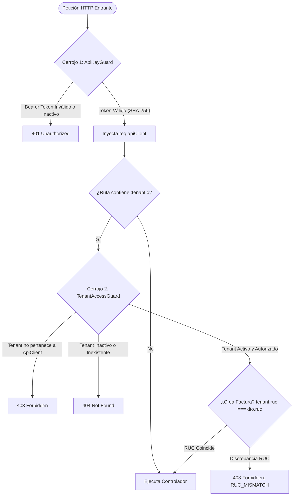
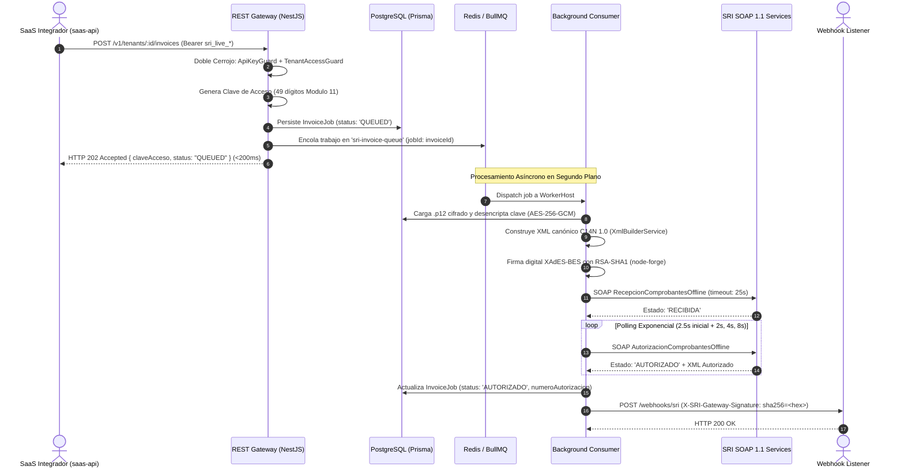

# Arquitectura 2-Tier B2B2B y Pipeline Asíncrono

`sri-invoice-gateway` es un microservicio de infraestructura diseñado para desacoplar a plataformas SaaS de alta concurrencia de la latencia e inestabilidad intrínsecas de los servicios web SOAP 1.1 del Servicio de Rentas Internas (SRI) del Ecuador.

---

## Modelo Jerárquico 2-Tier B2B2B

El sistema implementa una estricta jerarquía multi-inquilino de dos niveles diseñada para aislar permisos, secretos criptográficos y responsabilidades operativas:

```
+-------------------------------------------------------------------------------+
| Nivel 1: Integrador SaaS (saas-api)                                          |
| - Propietario de la Master API Key (`sri_live_<48_hex>`).                    |
| - Autentica peticiones backend-to-backend vía HTTP Bearer Token.              |
| - Recibe eventos asíncronos vía Webhooks firmados con HMAC-SHA256.           |
+-------------------------------------------------------------------------------+
                                    │
                                    │ Posee y gestiona múltiples
                                    ▼
+-------------------------------------------------------------------------------+
| Nivel 2: Empresas Emisoras / Contribuyentes (Tenants)                         |
| - Entidades jurídicas o personas naturales con RUC (13 dígitos).              |
| - Poseen su propio certificado digital `.p12`/`.pfx` firmado por ARCOTEL.     |
| - Emisión de comprobantes electrónicos (Factura v1.1.0).                       |
+-------------------------------------------------------------------------------+
```

### Roles y Desacoplamiento del Ecosistema

1. **`saas-api` (Backend Integrador)**:
   - Es el único actor autorizado para interactuar directamente con `sri-invoice-gateway`.
   - Almacena de forma segura la API Key maestra (`sri_live_*`).
   - Registra tenants, sube certificados digitales y envía solicitudes de facturación en lote.
2. **`saas-web` (Frontend / Dashboard de Usuario Final)**:
   - Consume exclusivamente `saas-api` a través de un patrón Backend-for-Frontend (BFF).
   - **Regla estricta de seguridad**: `saas-web` **NUNCA** almacena API Keys maestras ni invoca directamente a `sri-invoice-gateway`.
3. **`sri-invoice-gateway`**:
   - Microservicio sin interfaz gráfica de usuario externa (API REST headless + worker en cola Redis/BullMQ).
   - Gestiona criptografía XAdES-BES, firma XML, consumo SOAP 1.1 y reintentos automáticos.

---

## Doble Capa de Autorización (Double-Lock)

Para garantizar el aislamiento absoluto entre diferentes clientes SaaS y sus respectivas empresas contribuyentes, cada solicitud HTTP entrante es evaluada por un mecanismo de validación de doble cerrojo:



- **Nivel 1 (`ApiKeyGuard`)**: Extrae el token `Authorization: Bearer sri_live_*`, computa su hash SHA-256 y verifica que la cuenta SaaS exista y se encuentre activa (`isActive: true`).
- **Nivel 2 (`TenantAccessGuard`)**: Valida en base de datos que el `:tenantId` indicado en la ruta pertenezca de forma irrefutable al SaaS autenticado:
  ```sql
  SELECT * FROM tenants 
  WHERE id = :tenantId AND api_client_id = :apiClientId AND status = 'ACTIVE';
  ```
- **Nivel 3 (Invariante de Negocio)**: En operaciones de emisión, comprueba que el RUC del emisor declarado en el cuerpo del comprobante coincida con el RUC registrado para el tenant (`tenant.ruc === dto.ruc`).

---

## Pipeline de Ingestión Asíncrona (<200ms)

El servicio responde de manera síncrona en menos de 200 ms con el código `202 Accepted` y delega la firma digital y la comunicación con el SRI a un worker en segundo plano respaldado por **BullMQ** y **Redis**.



---

## Garantías de Idempotencia y Resiliencia

1. **Clave de Acceso Única**: La clave de acceso de 49 dígitos derivada mediante el algoritmo Módulo 11 es única por comprobante, garantizada mediante restricción de base de datos (`@unique` sobre `clave_acceso`).
2. **Deduplicación en BullMQ**: Cada trabajo se inserta en Redis utilizando el identificador único del comprobante (`jobId: invoiceJob.id`), previniendo procesamientos duplicados ante reintentos automáticos de la red.
3. **Mapeo Efímero de Claves Privadas**: La contraseña del certificado `.p12` se descifra con AES-256-GCM exclusivamente en el ámbito temporal de la función de firma y se desecha inmediatamente de memoria, previniendo fugas entre inquilinos.
