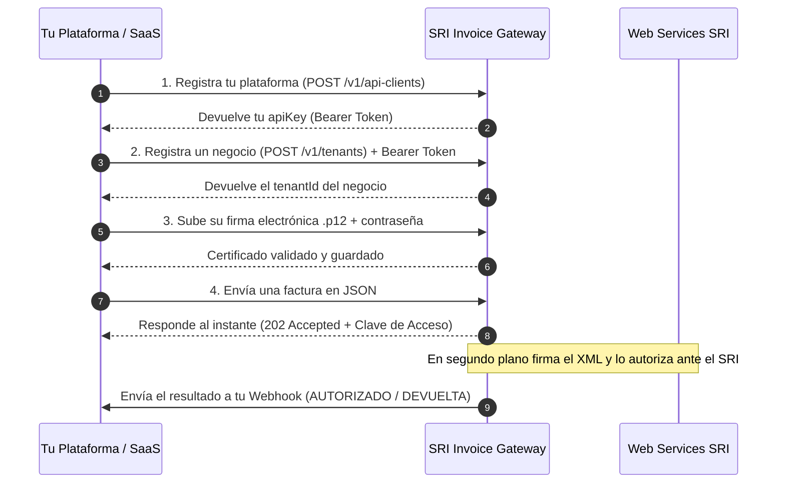

# Guía Rápida de Integración (Quickstart)

Integra la facturación electrónica del SRI de Ecuador en tu plataforma en **4 pasos simples**, sin preocuparte por firmar XMLs manualmente ni por las demoras o caídas del SRI.



---

## Paso 1: Registra tu plataforma y obtén tu API Key

Este registro se hace **una sola vez** por cada plataforma SaaS (desde el [formulario web](/guide/provisioning#formulario-de-registro), en Swagger `/docs` o con `curl`):

```bash
curl -X POST https://tu-api.up.railway.app/v1/api-clients \
  -H "Content-Type: application/json" \
  -d '{
    "name": "Mi Plataforma SaaS",
    "ruc": "1790011674001",
    "webhookUrl": "https://api.tusaas.com/webhooks/sri"
  }'
```

::: danger IMPORTANTE: GUARDA TU API KEY Y ÚSALA COMO BEARER TOKEN
* La clave `apiKey` (`sri_live_...`) solo se muestra **una única vez**. Cópiala y guárdala en tu `.env`.
* **Esa misma `apiKey` es el Bearer Token** que debes enviar en el header `Authorization: Bearer sri_live_...` (o en el botón **Authorize** de Swagger) cada vez que registres un negocio, subas una firma o emitas una factura.
* Tu **RUC** es único y se usará automáticamente en todas las facturas para cumplir la resolución del SRI (`RUC Proveedor`).
:::

---

## Paso 2: Registra un negocio emisor (Tenant)

Usa tu `apiKey` como **Bearer Token** para dar de alta a cada empresa o negocio que va a emitir facturas en tu sistema:

```bash
curl -X POST https://tu-api.up.railway.app/v1/tenants \
  -H "Authorization: Bearer sri_live_TU_API_KEY" \
  -H "Content-Type: application/json" \
  -d '{
    "businessName": "Empresa Demo S.A.",
    "ruc": "1790011674001"
  }'
```

La respuesta te devolverá el `id` del negocio (lo llamaremos `TENANT_ID`).

---

## Paso 3: Sube la firma electrónica (`.p12` o `.pfx`)

Sube el certificado digital del negocio junto con su contraseña usando tu **Bearer Token**:

```bash
curl -X POST https://tu-api.up.railway.app/v1/tenants/TENANT_ID/certificates \
  -H "Authorization: Bearer sri_live_TU_API_KEY" \
  -F "file=@/ruta/a/tu/firma.p12" \
  -F "password=TuPasswordDeFirma"
```

El microservicio comprueba automáticamente que el archivo sea válido, que esté vigente, que el RUC coincida con el negocio y guarda la clave protegida de forma segura.

---

## Paso 4: Emite una factura electrónica

Envía los datos de la factura en JSON. El servicio genera la clave de acceso de 49 dígitos y responde de inmediato (`202 Accepted`):

```bash
curl -X POST https://tu-api.up.railway.app/v1/tenants/TENANT_ID/invoices \
  -H "Authorization: Bearer sri_live_TU_API_KEY" \
  -H "Content-Type: application/json" \
  -d '{
    "referenceId": "FAC-2026-0001",
    "ambiente": "1",
    "razonSocial": "EMPRESA DEMO S.A.",
    "ruc": "1790011674001",
    "estab": "001",
    "ptoEmi": "001",
    "secuencial": "000000123",
    "dirMatriz": "Av. Amazonas y Colón, Quito",
    "fechaEmision": "10/11/2026",
    "dirEstablecimiento": "Av. Amazonas y Colón, Quito",
    "obligadoContabilidad": "SI",
    "tipoIdentificacionComprador": "07",
    "razonSocialComprador": "CONSUMIDOR FINAL",
    "identificacionComprador": "9999999999999",
    "totalSinImpuestos": 100.00,
    "totalDescuento": 0.00,
    "propina": 0.00,
    "importeTotal": 115.00,
    "moneda": "DOLAR",
    "pagos": [
      { "formaPago": "20", "total": 115.00 }
    ],
    "detalles": [
      {
        "codigoPrincipal": "SERV-01",
        "descripcion": "Consultoría de Software",
        "cantidad": 1,
        "precioUnitario": 100.00,
        "descuento": 0.00,
        "precioTotalSinImpuesto": 100.00,
        "impuestos": [
          {
            "codigo": "2",
            "codigoPorcentaje": "4",
            "tarifa": 15,
            "baseImponible": 100.00,
            "valor": 15.00
          }
        ]
      }
    ]
  }'
```

### ¿Cómo recibes el resultado del SRI?
Tienes dos opciones:
1. **Automático por Webhook**: Apenas el SRI autoriza o rechaza la factura, enviamos el resultado completo a tu `webhookUrl`. ([Ver cómo configurar tu Webhook](/guide/webhooks#como-configurar-tu-webhook)).
2. **Consultando por Clave de Acceso**:
   ```bash
   curl https://tu-api.up.railway.app/v1/tenants/TENANT_ID/invoices/CLAVE_ACCESO_49_DIGITOS \
     -H "Authorization: Bearer sri_live_TU_API_KEY"
   ```
