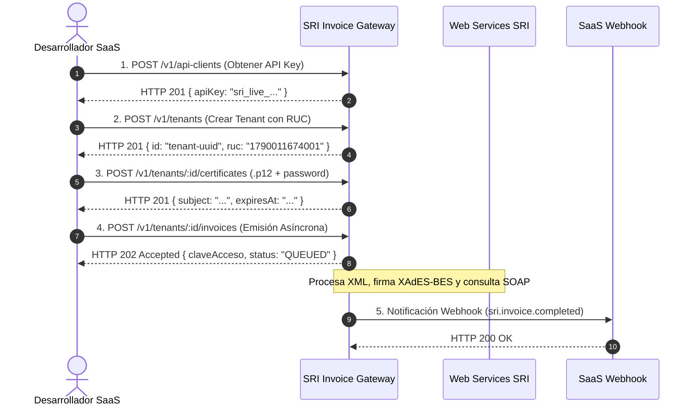

# Guía Rápida de Integración (Quickstart)

Bienvenido a la guía de inicio rápido para desarrolladores de **SRI Invoice Gateway**. En menos de 5 minutos podrás provisionar tu cliente de API, registrar tu primera empresa emisora (tenant), configurar su firma digital y emitir tu primera factura electrónica.

---

## Flujo de Integración en 3 Pasos



---

## Paso 1: Provisionar Cliente SaaS

Genera una credencial de acceso para tu plataforma SaaS. Esta clave maestra (`sri_live_*`) se utilizará en el encabezado `Authorization: Bearer <api_key>` en todas las llamadas subsiguientes:

```bash
curl -X POST https://api.gateway.com/v1/api-clients \
  -H "Content-Type: application/json" \
  -d '{
    "name": "Mi Plataforma SaaS ERP",
    "webhookUrl": "https://erp.misas.com/webhooks/sri"
  }'
```

::: warning GUARDA TU API KEY
La API key solo se devuelve una única vez durante el aprovisionamiento. En la base de datos únicamente se almacena su hash SHA-256.
:::

---

## Paso 2: Registrar Tenant y Firma Electrónica

### 2.1 Crear la Empresa Emisora

```bash
curl -X POST https://api.gateway.com/v1/tenants \
  -H "Authorization: Bearer sri_live_TU_API_KEY" \
  -H "Content-Type: application/json" \
  -d '{
    "name": "Empresa Demo S.A.",
    "ruc": "1790011674001",
    "legalName": "EMPRESA DEMOSTRATIVA S.A.",
    "email": "facturacion@demo.com",
    "address": "Av. Amazonas y Colón, Quito"
  }'
```

### 2.2 Cargar Certificado Digital `.p12`

El archivo de firma `.p12` o `.pfx` debe estar emitido por una Autoridad de Certificación acreditada por ARCOTEL (Banco Central del Ecuador, Security Data, Uanataca, ANF, Consejo de la Judicatura):

```bash
curl -X POST https://api.gateway.com/v1/tenants/TENANT_ID/certificates \
  -H "Authorization: Bearer sri_live_TU_API_KEY" \
  -F "file=@/ruta/a/tu/firma.p12" \
  -F "password=TuPasswordDeFirma"
```

El gateway valida en memoria que el RUC del certificado coincida con el RUC del tenant y almacena la clave privada encriptada con **AES-256-GCM**.

---

## Paso 3: Emitir Factura Electrónica

Envía el comprobante en formato JSON. El gateway validará la información, generará la clave de acceso de 49 dígitos (Módulo 11) y encolará la emisión:

```bash
curl -X POST https://api.gateway.com/v1/tenants/TENANT_ID/invoices \
  -H "Authorization: Bearer sri_live_TU_API_KEY" \
  -H "Content-Type: application/json" \
  -d '{
    "ambiente": 1,
    "tipoEmision": 1,
    "secuencial": "000000001",
    "fechaEmision": "09/11/2026",
    "infoFactura": {
      "tipoIdentificacionComprador": "05",
      "razonSocialComprador": "CONSUMIDOR FINAL",
      "identificacionComprador": "9999999999999",
      "totalSinImpuestos": 100.00,
      "totalDescuento": 0.00,
      "totalConImpuestos": [
        {
          "codigo": "2",
          "codigoPorcentaje": "4",
          "baseImponible": 100.00,
          "valor": 15.00
        }
      ],
      "importeTotal": 115.00
    },
    "detalles": [
      {
        "codigoPrincipal": "SERV-01",
        "descripcion": "Consultoría Técnica de Software",
        "cantidad": 1,
        "precioUnitario": 100.00,
        "descuento": 0.00,
        "precioTotalSinImpuesto": 100.00,
        "impuestos": [
          {
            "codigo": "2",
            "codigoPorcentaje": "4",
            "tarifa": 15.0,
            "baseImponible": 100.00,
            "valor": 15.00
          }
        ]
      }
    ],
    "pagos": [
      {
        "formaPago": "01",
        "total": 115.00
      }
    ]
  }'
```

### Respuesta Inmediata (`< 200 ms`)

```json
{
  "claveAcceso": "0911202601179001167400110010010000000011234567812",
  "status": "QUEUED",
  "jobId": "job-d41d8cd98f00b204e9800998ecf8427e",
  "estimatedProcessingTimeMs": 2500
}
```

---

## Próximos Pasos

- Consulta la [Arquitectura 2-Tier B2B2B](/guide/architecture) para comprender el flujo interno y BullMQ.
- Revisa la especificación completa de la [Clave de Acceso y Módulo 11](/guide/modulo11).
- Implementa la recepción de notificaciones en [Webhooks & HMAC-SHA256](/guide/webhooks).
- Explora la [Referencia Completa de Endpoints REST](/api/endpoints).
