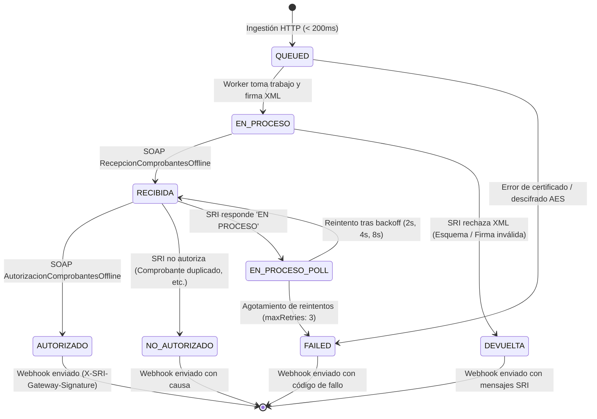

# Máquina de Estados SRI y Estrategia de Sondeo

Durante el procesamiento de un comprobante electrónico, `sri-invoice-gateway` transiciona el trabajo a través de una serie de estados bien definidos. Esta máquina de estados refleja tanto el progreso interno en la cola como las respuestas oficiales del Servicio de Rentas Internas (SRI).

---

## Diagrama de la Máquina de Estados



---

## Definición de Estados

| Estado | Significado Técnico | Acción del Integrador SaaS |
| :--- | :--- | :--- |
| **`QUEUED`** | La petición fue aceptada síncronamente (`202 Accepted`) y se encuentra en la cola Redis/BullMQ a la espera de un worker disponible. | Ninguna. Esperar webhook o consultar por clave de acceso. |
| **`RECIBIDA`** | El comprobante XML firmado con XAdES-BES fue transmitido exitosamente al servicio SOAP de recepción del SRI y superó la validación inicial de sintaxis. | Ninguna. El worker iniciará el sondeo de autorización automáticamente. |
| **`EN_PROCESO`** | El SRI ha recibido el comprobante pero aún se encuentra procesándolo en sus lotes internos de autorización. | El gateway ejecuta la política de retroceso exponencial descrita abajo. |
| **`AUTORIZADO`** | **Estado Terminal Exitoso**. El SRI autorizó la validez tributaria del comprobante. Incluye `numeroAutorizacion`, `fechaAutorizacion` y el XML con la etiqueta `<autorizacion>`. | Almacenar XML autorizado y poner a disposición del cliente final. |
| **`DEVUELTA`** | **Estado Terminal con Error de Recepción**. El SRI rechazó el comprobante durante la recepción debido a errores formales (esquema XSD inválido, certificado no reconocido, firma corrupta). | Revisar el arreglo `sriMessages` para corregir los datos del comprobante. |
| **`NO_AUTORIZADO`** | **Estado Terminal con Rechazo Tributario**. El comprobante fue recibido pero no autorizado (ej. emisor no autorizado, RUC suspendido, secuencial ya emitido). | Analizar los motivos devueltos por el SRI y subsanar tributariamente. |
| **`FAILED`** | **Estado Terminal de Fallo Crítico**. Se produjo un error interno no recuperable (ej. certificado vencido, timeout de red exhausto, fallo al contactar los servidores del SRI). | Verificar configuración de credenciales del tenant o reintentar más tarde. |

---

## Política de Sondeo con Retroceso Exponencial

Cuando el SRI responde con estado `EN PROCESO` en la consulta de autorización, el worker no satura los servidores del SRI con peticiones continuas. En su lugar, aplica una estrategia de **sondeo acotado con retroceso exponencial (Bounded Exponential Backoff)**:

```
Paso 1: Espera Inicial Obligatoria
        └── 2,500 ms (permite al SRI indexar el lote)

Paso 2: Consulta 1 a AutorizacionComprobantesOffline
        ├── ¿Estado === 'AUTORIZADO'? ──► FIN (Éxito)
        └── ¿Estado === 'EN PROCESO'? ──► Reintento 1: Espera 2,000 ms

Paso 3: Consulta 2 a AutorizacionComprobantesOffline
        ├── ¿Estado === 'AUTORIZADO'? ──► FIN (Éxito)
        └── ¿Estado === 'EN PROCESO'? ──► Reintento 2: Espera 4,000 ms

Paso 4: Consulta 3 a AutorizacionComprobantesOffline
        ├── ¿Estado === 'AUTORIZADO'? ──► FIN (Éxito)
        └── ¿Estado === 'EN PROCESO'? ──► Reintento 3: Espera 8,000 ms

Paso 5: Agotamiento de Reintentos (maxRetries = 3)
        └── Si persiste en 'EN PROCESO', el trabajo se marca como FAILED o se programa para sondeo retardado.
```

- **Tiempo de Espera Inicial**: `2,500 ms` tras la recepción exitosa.
- **Intervalos de Reintento**: Multiplicador $2^n \times 1,000 \text{ ms}$ (`2,000 ms`, `4,000 ms`, `8,000 ms`).
- **Límite Máximo**: 3 reintentos. Esto previene el bloqueo indefinido de workers en la cola ante caídas prolongadas del SRI.

---

## Estructura de Mensajes de Error del SRI

Cuando un comprobante resulta `DEVUELTA` o `NO_AUTORIZADO`, la respuesta y el webhook contienen el arreglo de objetos `sriMessages`:

```json
{
  "status": "DEVUELTA",
  "sriMessages": [
    {
      "identificador": "43",
      "mensaje": "CLAVE ACCESO REGISTRADA",
      "informacionAdicional": "El comprobante ya fue emitido y autorizado previamente con la misma clave de acceso.",
      "tipo": "ERROR"
    }
  ]
}
```

- **`identificador`**: Código numérico oficial del catálogo de errores del SRI (ej. `43` clave ya registrada, `35` certificado inválido, `58` emisor no autorizado).
- **`mensaje`**: Título canónico del error según la especificación técnica del SRI.
- **`informacionAdicional`**: Detalle contextual emitido por el validador del SRI.
- **`tipo`**: Gravedad reportada (`ERROR` o `ADVERTENCIA`).
