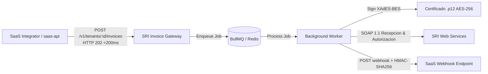

## Arquitectura de Integración 2-Tier

### ¿Por qué SRI Invoice Gateway?

El SRI de Ecuador impone estrictos requisitos para la emisión de comprobantes electrónicos offline:
- **XML Canónico y XAdES-BES**: Requiere firma digital RSA-SHA1 con digest value sobre el comprobante y el certificado digital `.p12`.
- **Clave de Acceso de 49 Dígitos**: Cálculo ponderado con algoritmo Módulo 11 (pesos cíclicos 2..7 de derecha a izquierda).
- **Desacoplamiento Asíncrono**: Los servicios SOAP del SRI pueden presentar intermitencia o latencias superiores a 5 segundos; el gateway responde en menos de 200 ms y gestiona reintentos exponenciales en segundo plano.
- **Seguridad Multi-Tenant B2B2B**: Gestión centralizada de múltiples empresas emisoras bajo una misma plataforma SaaS con encriptación AES-256-GCM para llaves privadas.
